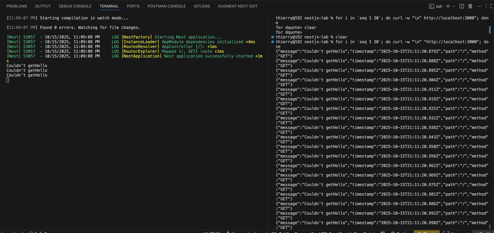

# Circuit breaker

## The idea

When a route depends on something that keeps failing, like a database or another service, calling it on every request wastes time and adds load to something already broken. A circuit breaker counts failures. After too many in a row it "opens" and, for a while, rejects calls without running them. Then it lets calls through again to check whether things have recovered, and "closes" once they succeed.

## What I built

- [`src/interceptors/circuit-breaker.ts`](src/interceptors/circuit-breaker.ts): the breaker. It opens after 3 failures in a row, stays open for 60 s, then lets calls through again; 3 successes close it, and 1 failure opens it again.
- [`src/interceptors/circuit-breaker.interceptor.ts`](src/interceptors/circuit-breaker.interceptor.ts): a Nest interceptor that gives each route its own breaker.
- [`src/app.controller.ts`](src/app.controller.ts): the test route. `GET /` always throws a 400 and logs `Couldn't getHello` each time it runs.

To check it, I sent 30 requests in a loop. The server (left) logged `Couldn't getHello` three times, and every response (right) is the same 400:



## What I learned

- While the circuit was open, the route's code no longer ran, but clients still got the same `400 Couldn't getHello` as before. Nothing in the response said the circuit was open. The e2e test ([`test/circuit-breaker.e2e-spec.ts`](test/circuit-breaker.e2e-spec.ts)) checks it: 5 requests, the route runs 3 times.
- The breaker counts every error, including 400s: three bad requests were enough to open the circuit.
- Each route has its own breaker, so a failing route doesn't block the others. A unit test checks it.

## How to run

From the repository root:

```sh
pnpm start:exp circuit-breaker-pattern
```

In another terminal:

```sh
for i in 1 2 3 4 5; do curl -s localhost:3000; echo; done
```

All five responses are the same 400 error, but the server logs `Couldn't getHello` only three times. After 60 s, the next request runs the route again.

Tests:

```sh
pnpm --filter experiment--circuit-breaker-pattern test
```
